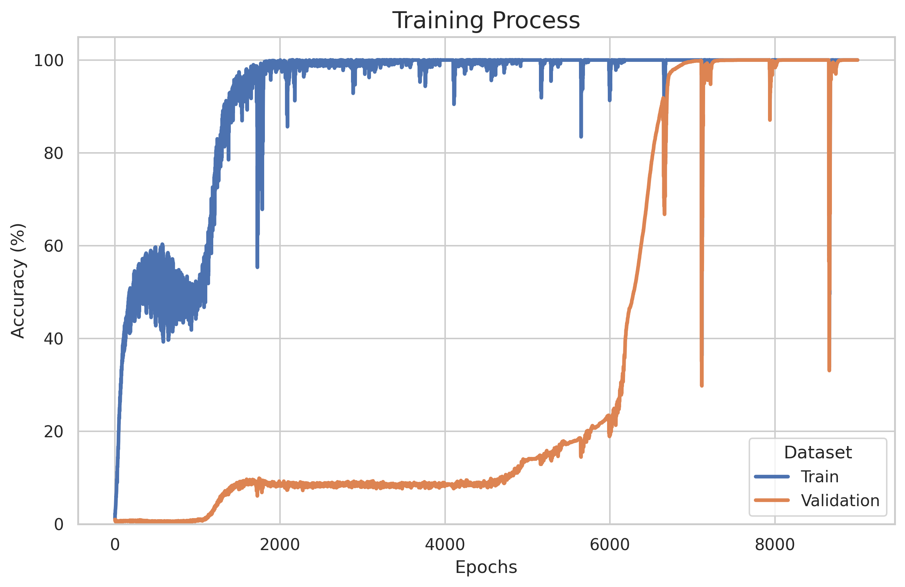

# Grokking

Research code on **grokking** [[1]](#references), the delayed-generalization
phenomenon in which a network fits its training set long before it starts
to generalize. The repo trains small custom transformers on synthetic
algorithmic tasks: complex-number multiplication in several encodings and
train/validation splits, plus modular addition, the original grokking
benchmark.

The project started as a study of the learned embeddings in these models,
carried out with my supervisor. The research later moved in a different
direction, so this repository is a self-contained snapshot of the
training framework and experiments, not an ongoing project.

## Example result: modular addition



Single-layer `DOT` (single-head attention, `d_model = 128`) trained on
`(a + b) mod 83`, with 30% of the 6,889 pairs used for training and the rest
for validation. AdamW, `lr = 1e-3`, `weight_decay = 1.0`, full-batch, seed 42.
The full config is in `analysis/DOT_M/exp_005/config.json`; the first ~9,000
epochs are shown. To rerun:

```
python train.py --experiment DOT_M --N 83 --weight-decay 1.0 --train-frac 0.3
```

- Training accuracy rises quickly to 40–60% and oscillates in that range until
  epoch ~1,100, then climbs to ~100% by epoch ~1,800.
- Validation accuracy stays near 1% until epoch ~1,100, rises to ~9% and
  plateaus there until epoch ~4,500.
- It then increases slowly to ~23% by epoch ~6,000, followed by a steep rise
  to ~90% by epoch ~6,700, and reaches ~100% by epoch ~7,100.
- Throughout training there are brief drops in training accuracy. The largest
  late ones (around epochs ~6,700, ~7,150 and ~8,650) also pull validation
  accuracy down, to ~30% at the lowest, after which both curves recover
  within a few dozen epochs.

## Structure

```
.
├── train.py            # CLI entry point
├── configs.py          # experiment registry (EXPERIMENTS)
├── core/
│   ├── models.py       # architectures: DOT, MHDOT, NAT + GetModel factory
│   ├── datasets.py     # synthetic datasets, DATASET_REGISTRY, BuildDatasets
│   ├── engine.py       # full-batch train / validation step
│   ├── config.py       # CLI arguments -> run config
│   ├── checkpoints.py  # run directories, config.json, checkpoints
│   └── metrics.py      # metrics.csv logging, accuracy plot
├── tests/              # pytest sanity checks
├── analysis/           # curated results per experiment
└── runs/               # gitignored output written by train.py
```

## Installation

Requires Python 3.10+ (developed on 3.11):

```
pip install -r requirements.txt
```

CPU-only PyTorch is enough; the datasets are small.

## Running an experiment

```
python train.py --list                         # registered experiments
python train.py --experiment DOT_CN --N 5      # run with default training settings
python train.py --experiment DOT_CN --N 5 --lr 3e-4 --weight-decay 0.5 --seed 0
```

| Flag | Default | Meaning |
|---|---|---|
| `--experiment` | required | name from `--list` |
| `--N` | required | problem size: operand range `[-N, N]` for complex tasks, modulus `p` for `DOT_M` |
| `--epochs` | 20000 | number of epochs (one full-batch step each) |
| `--lr` | 1e-3 | AdamW learning rate |
| `--weight-decay` | 0.15 | AdamW weight decay |
| `--train-frac` | 0.4 | train fraction; used only by randomly split datasets |
| `--seed` | 42 | seed for the data split and weight init |
| `--save-every` | 500 | save a checkpoint and the plot every N epochs |
| `--print-every` | 100 | print losses and accuracies every N epochs |

Training is full-batch: the whole training set is one batch, so one epoch
is one optimizer step. The model architecture comes from the experiment
config in `configs.py`. The docstring of each config lists the training
flags used in earlier runs of that experiment.

Each run creates an auto-numbered directory `runs/<EXPERIMENT>/exp_XXX/` with:

- `config.json`: the full config (architecture, dataset, training hyperparameters),
- `metrics.csv`: `epoch, train_loss, train_acc, val_loss, val_acc` for every epoch,
- `checkpoint_epoch_N.pt`: model and optimizer state every `--save-every` epochs and after the last one,
- `acc_plot.png`: train/validation accuracy curve.

Accuracy is exact-match: an example counts as correct only if every output
token is predicted correctly.

## Tests

```
pip install pytest
pytest
```

Checks that every registered experiment builds and trains for a few steps
on CPU, and that every dataset produces correct targets, valid token ids and
a clean train/val split. Runs in seconds.

## Architectures (`core/models.py`)

| Name | Description |
|---|---|
| `DOT` | Transformer with learned token and positional embeddings, `n_layers` pre-norm blocks with single-head attention and a ReLU MLP, and one linear output head per output token, read from the last position |
| `MHDOT` | Same layout with multi-head attention (`n_heads`) |
| `NAT` | Neuron-Astrocyte Transformer: linear-time attention via random Fourier features with an exponentially decaying accumulated state, inspired by [[2]](#references); two output heads only |

Notes:

- Attention in `DOT` and `MHDOT` has no causal mask; every position attends to the whole sequence.
- `MHDOT` needs an extra `setup` key `n_heads` (`d_model` must be divisible by it); see `MHDOT_CN`. `NAT` needs `m_hidden`, has no registered experiment yet, and supports only tasks with two output tokens (`CN`, `CNA`, `CNC`).

## Datasets (`core/datasets.py`)

Complex tasks enumerate all `a, b, c, d ∈ [-N, N]`. Values are shifted by
`2N²` to become non-negative token ids, giving a vocabulary of `4N² + 1`.

| Name | Task | Output tokens | Split |
|---|---|---|---|
| `M` | `(a + b) mod p` [[1]](#references) | 1 | random |
| `CN` | `(a+bi)(c+di)`, input `[a, b, c, d]` | 2 (re, im) | random |
| `CNA` | same as `CN` | 2 | train: `(a, b) ≤ (c, d)` lexicographically; val: the rest |
| `CNC` | same as `CN` | 2 | train: `b > 0 and d > 0`; val: the rest |
| `CNFM` | complex numbers as 2×2 real matrices `[[a, -b], [b, a]]`, input 8 tokens | 4 (product matrix) | random |
| `CNFMA` | same as `CNFM` | 4 | train: each unordered pair in forward order; val: same pairs with operands swapped |

## Adding an experiment

1. **Existing dataset and architecture:** add a config function to
   `configs.py` (see `DOT_CN`) and register it in `EXPERIMENTS`.
2. **New dataset:** add a class to `core/datasets.py` and register it in
   `DATASET_REGISTRY`. If it builds its own split from a
   `split="train"` / `split="val"` argument instead of a random one,
   also add its name to `SPLIT_AWARE`.
3. **New architecture:** add it to `core/models.py` and wire it into `GetModel`.

`train.py` picks everything up through the registries.

> **Note on `analysis/`:** plots in older experiment folders are titled
> "Grokking Progress: Modular Addition" regardless of the task, because the
> title was hardcoded at the time. Trust the folder name and `config.json`.

## References

[1] A. Power, Y. Burda, H. Edwards, I. Babuschkin, and V. Misra, "Grokking: Generalization beyond overfitting on small algorithmic datasets," arXiv:2201.02177, 2022. doi: [10.48550/arXiv.2201.02177](https://doi.org/10.48550/arXiv.2201.02177)

[2] L. Kozachkov, K. V. Kastanenka, and D. Krotov, "Building transformers from neurons and astrocytes," *Proc. Natl. Acad. Sci. U.S.A.*, vol. 120, no. 34, p. e2219150120, 2023. doi: [10.1073/pnas.2219150120](https://doi.org/10.1073/pnas.2219150120)